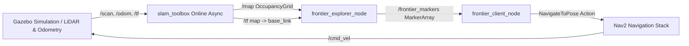

# Autonomous 2D Frontier-Based Exploration in ROS 2 Jazzy

[](https://docs.ros.org/en/jazzy/)
[](https://www.python.org/)
[](https://gazebosim.org/)
[](https://navigation.ros.org/)

Autonomous frontier-based 2D exploration and mapping system implemented in **ROS 2 Jazzy**, integrating **slam_toolbox**, **Nav2**, and **Gazebo** simulation. Developed for **EL7009 - Mobile Robotics** at the **University of Chile (FCFM)**.

The robot autonomously explores unknown indoor environments without human intervention by detecting occupancy-grid frontiers (boundaries between known free space and unknown space) and dispatching asynchronous navigation goals.

<div align="center">
  
</div>

---

## System Architecture



### Core ROS 2 Nodes (`frontier_exploration`)

| Node | Script | Subscribed Topics / TF | Published Topics / Actions | Responsibility |
| :--- | :--- | :--- | :--- | :--- |
| **`frontier_explorer_node`** | `explorer_node.py` | `/map` (`nav_msgs/OccupancyGrid`), TF `map -> base_link` | `/frontier_markers` (`visualization_msgs/MarkerArray`) | Scans the occupancy grid for free cells ($0$) adjacent to unknown cells ($-1$) in an 8-connected neighborhood, transforms grid coordinates to the `map` frame, and filters candidates near the robot footprint. |
| **`frontier_client_node`** | `navigation_node.py` | `/frontier_markers` (`visualization_msgs/MarkerArray`), TF `map -> base_link` | `/navigate_to_pose` (`nav2_msgs/action/NavigateToPose`), `/goal_pose` (`geometry_msgs/PoseStamped`) | Evaluates candidate frontiers using Euclidean distance, maintains spatial blacklists for visited/unreachable regions ($0.3\text{ m}$ radius), adapts the minimum travel horizon ($0.7\text{ m} \rightarrow 0.3\text{ m}$), and manages asynchronous Nav2 action execution. |

---

## Installation & Quick Start

**Prerequisites:** Ubuntu 24.04 + **ROS 2 Jazzy Jalisco**.

```bash
# 1. Clone the repository
git clone https://github.com/Kitsuneden02/el7009_2d_exploration.git
cd el7009_2d_exploration

# 2. Install ROS 2 SLAM & Navigation dependencies
sudo apt install ros-jazzy-slam-toolbox ros-jazzy-navigation2 ros-jazzy-nav2-bringup
pip install -r requirements.txt

# 3. Build and source the workspace
colcon build --symlink-install
source install/setup.bash
```

### Running the Simulation

Run each launch file in a separate terminal (with the workspace sourced):

```bash
# Terminal 1: Launch differential-drive robot and Gazebo environment
ros2 launch el7009_diff_drive_robot robot.launch.py

# Terminal 2: Launch online asynchronous SLAM (slam_toolbox) and Nav2 stack
ros2 launch frontier_exploration slam_n_nav.launch.py

# Terminal 3: Start autonomous frontier detector and navigation client
ros2 launch frontier_exploration exploration.launch.py
```

> **Optional (Hospital Environment):** To use the hospital Gazebo world models, export `GZ_SIM_RESOURCE_PATH` before launching:
> ```bash
> export GZ_SIM_RESOURCE_PATH=$(pwd)/src/el7009_diff_drive_robot/models/hospital/model
> ```

---

## Español: Descripción del Proyecto

Implementación del Proyecto N°3 del curso **EL7009 - Robótica Móvil** (Universidad de Chile). El sistema integra exploración autónoma basada en detección de fronteras (Yamauchi, 1997) utilizando **slam_toolbox** y **Nav2** sobre **ROS 2 Jazzy** y simulación en **Gazebo**.

El robot navega de forma autónoma hacia las fronteras del mapa, generando metas de navegación asíncronas en las zonas de transición entre el espacio libre conocido y el espacio desconocido hasta completar el mapeo 2D del entorno.

---

## References

- Yamauchi, B. (1997). *A Frontier-Based Approach for Autonomous Exploration*. IEEE International Symposium on Computational Intelligence in Robotics and Automation (CIRA'97).
- [slam_toolbox](https://github.com/SteveMacenski/slam_toolbox)
- [Nav2: ROS 2 Navigation Stack](https://github.com/ros-planning/navigation2)
- [TurtleBot3 Simulations](https://github.com/ROBOTIS-GIT/turtlebot3_simulations)
- [Dataset of Gazebo Worlds and Maps (Michael Herd)](https://github.com/mlherd/Dataset-of-Gazebo-Worlds-Models-and-Maps)
